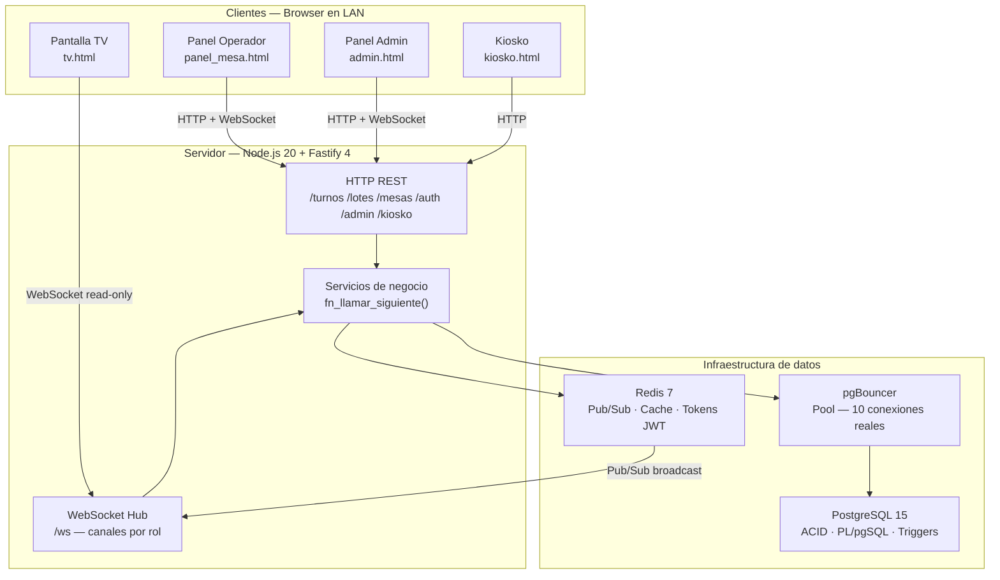
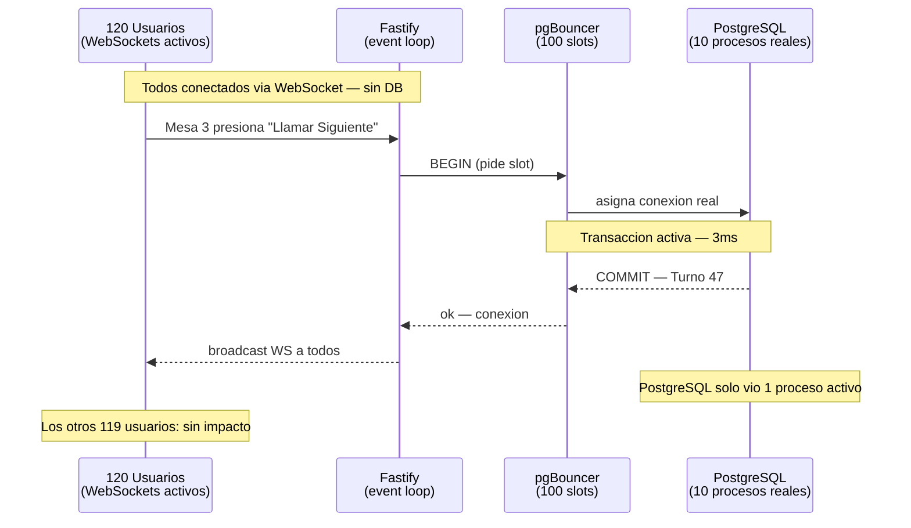
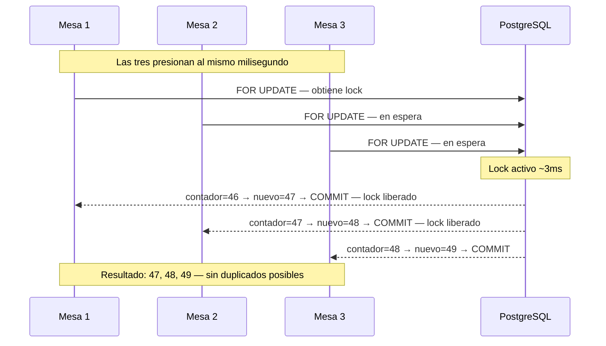
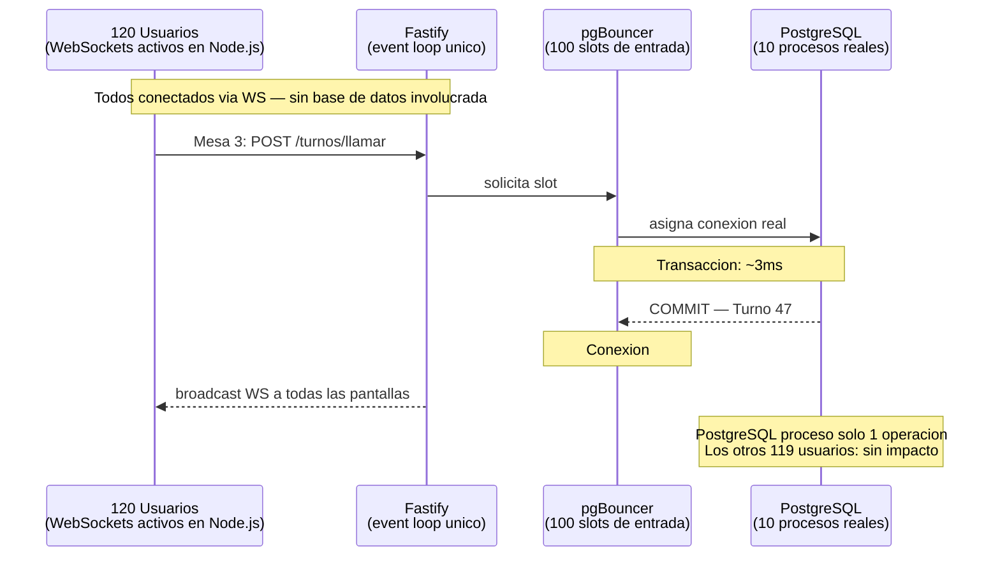
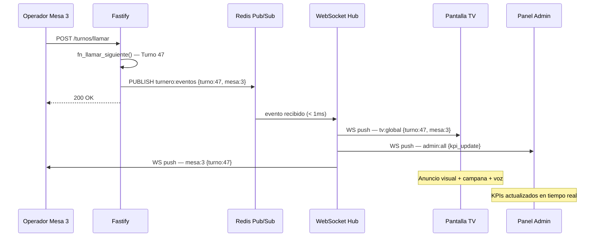
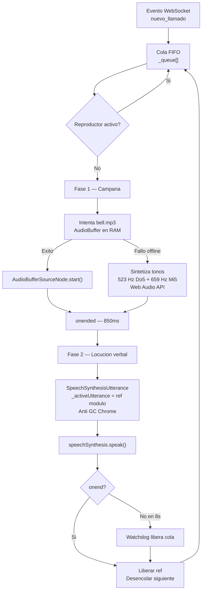
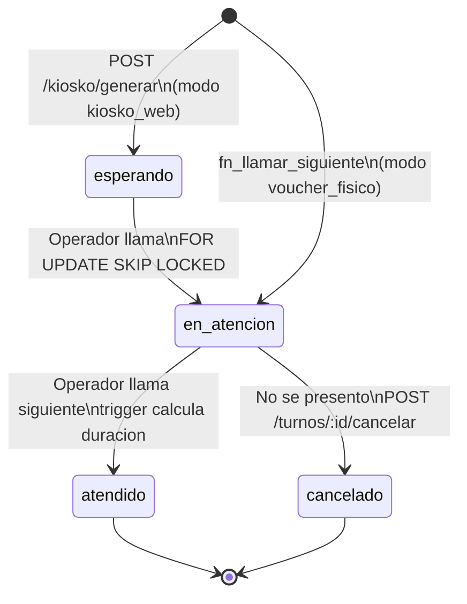

# Arquitectura Tecnica — Turnero de Matriculas 2026 (v2.1)

> Documento de referencia con nivel de detalle operativo. Explica el funcionamiento interno, las decisiones de diseno y los mecanismos que garantizan consistencia bajo condiciones reales de uso. Conocimiento basico de backend y bases de datos relacionales es suficiente para seguirlo.

---

## Tabla de Contenidos

1. [Contexto y Principios de Diseno](#1-contexto-y-principios-de-diseno)
2. [Arquitectura General](#2-arquitectura-general)
3. [Decisiones Tecnologicas](#3-decisiones-tecnologicas)
4. [Estructura del Codigo](#4-estructura-del-codigo)
5. [Flujos de Trabajo Principales](#5-flujos-de-trabajo-principales)
6. [Desafio 1 — Race Condition y Asignacion Atomica](#6-desafio-1--race-condition-y-asignacion-atomica)
7. [Desafio 2 — Alta Concurrencia y pgBouncer](#7-desafio-2--alta-concurrencia-y-pgbouncer)
8. [Desafio 3 — Multiples Turnos Simultaneos en TV](#8-desafio-3--multiples-turnos-simultaneos-en-tv)
9. [Desafio 4 — Caida, Reconexion y Snapshot](#9-desafio-4--caida-reconexion-y-snapshot)
10. [Desafio 5 — WebSockets y Broadcast](#10-desafio-5--websockets-y-broadcast)
11. [Desafio 6 — Idempotencia](#11-desafio-6--idempotencia)
12. [Desafio 7 — Sistema de Audio Hibrido](#12-desafio-7--sistema-de-audio-hibrido)
13. [Base de Datos — Schema y Funciones](#13-base-de-datos--schema-y-funciones)
14. [Inventario Tecnologico Completo](#14-inventario-tecnologico-completo)
15. [Resumen de Garantias](#15-resumen-de-garantias)

---

## 1. Contexto y Principios de Diseno

El sistema opera en una red local (LAN) durante jornadas masivas de atencion presencial: multiples mesas en paralelo, docenas de dispositivos conectados y condiciones de red impredecibles — switches saturados, cables desconectados, equipos que se reinician en el peor momento.

Cuatro principios guian toda decision de diseno:

1. **Cero dependencias externas en tiempo de ejecucion.** Si el router pierde la salida a la nube, las mesas siguen atendiendo, la TV sigue mostrando turnos. Fuentes tipograficas, CSS, librerias JavaScript y archivos de audio estan autoalojados en el servidor local.

2. **Consistencia transaccional absoluta.** Dos mesas nunca pueden llamar el mismo numero de turno. Toda operacion critica es atomica: ocurre completamente o no ocurre en absoluto.

3. **Tolerancia autonoma a fallos de red.** Cada dispositivo tiene la logica de reconexion integrada. Se recupera solo, sin recargar la pagina y sin borrar el estado visible.

4. **Latencia sub-20ms en la ruta critica.** Un clic del operador debe verse reflejado en la pantalla del auditorio en menos de 20 milisegundos.

---

## 2. Arquitectura General



---

## 3. Decisiones Tecnologicas

### Por que Fastify en lugar de Express

Express es el framework Node.js mas usado, pero fue disenado cuando el rendimiento no era el problema principal. Internamente recorre una cadena de middlewares de forma generica por cada peticion, sin saber de antemano que estructura tendra el body.

Fastify resuelve esto de dos formas concretas:

- Su enrutador (find-my-way) organiza las rutas como un arbol de prefijos. Encontrar la ruta correcta es O(log n) en lugar de O(n).
- Cada ruta declara un **JSON Schema**. Fastify compila un validador nativo con Ajv antes de que llegue cualquier peticion, rechazando peticiones malformadas en microsegundos sin tocar la base de datos.

Express: 12,000–15,000 req/s. Fastify: mas de 70,000 req/s. Para este sistema la diferencia importa en latencia bajo carga simultanea, no en volumen absoluto.

---

### Por que PostgreSQL 15 en lugar de MySQL o MongoDB

La decision se basa en tres primitivas que este sistema necesita y que no tienen equivalente real en otras bases de datos:

**Transacciones ACID estrictas.** No existe estado intermedio aceptable. O el turno se registro completo (numero, mesa, operador, timestamp) o la operacion entera se revierte. MongoDB en su configuracion predeterminada no garantiza esto en operaciones con multiples documentos.

**SELECT ... FOR UPDATE.** Bloqueo exclusivo a nivel de fila durante la transaccion. Es el mecanismo exacto que elimina la race condition (ver seccion 6). MySQL lo tiene, pero sin la eficiencia del motor MVCC de PostgreSQL.

**Funciones PL/pgSQL almacenadas.** La funcion fn_llamar_siguiente ejecuta en un solo viaje lo que requeriria 4-5 round-trips de red entre Node.js y la base de datos. Reducir 4 viajes a 1 recorta el tiempo de ~40ms a ~3ms.

---

### Por que pgBouncer entre Fastify y PostgreSQL

PostgreSQL crea un **proceso separado del sistema operativo** por cada conexion abierta (fork()). Cada proceso reserva entre 5 MB y 10 MB de RAM para sus buffers, independientemente de si esta ejecutando una consulta o esperando inactivo. Con 50 conexiones directas: 500 MB solo en overhead de conexiones. Con 120 usuarios: impracticable.

La clave para entender pgBouncer es distinguir tres cosas que no son lo mismo:

| Tipo de "conexion" | Quien la maneja | Cuantas simultaneas |
|---|---|---|
| Usuarios conectados (WebSocket/HTTP) | Node.js event loop | Miles — 1 solo hilo |
| Slots de entrada a pgBouncer | pgBouncer | Hasta 100 |
| Conexiones reales a PostgreSQL | PostgreSQL | Exactamente 10 |

Node.js maneja miles de conexiones de red con un solo hilo asincrono — nunca bloquea. De esas, solo las que estan ejecutando una transaccion SQL en ese momento necesitan una conexion al pool. Una transaccion de llamado de turno dura ~3ms. Con 10 conexiones reales, el pool puede servir mas de **3,000 transacciones por segundo**. 120 usuarios haciendo operaciones esporadicas nunca saturan eso.



---

### Por que Redis 7

Redis opera enteramente en RAM. Escribir o leer un valor tarda menos de 0.5ms. Se usa en dos roles:

**Pub/Sub para broadcast WebSocket.** Cuando un operador llama un turno, Fastify publica el evento en Redis. Todas las instancias del hub suscritas lo reciben y lo retransmiten a sus clientes. Si en el futuro hubiera dos instancias de Fastify balanceadas, el evento del Servidor A llega automaticamente a los clientes del Servidor B. El acoplamiento entre instancias es cero.

**Estado efimero de corta vida.** Tokens de sesion WS (TTL 30s), blacklist de tokens JWT revocados (TTL igual al tiempo restante), cache de snapshots de TV (TTL 3s).

---

### Por que el frontend es HTML5 + Tailwind + Alpine.js sin React ni Vue

React, Vue y similares fueron disenados para aplicaciones donde el estado del cliente es complejo y el arbol de componentes tiene decenas de niveles. Una tienda en linea, un editor colaborativo.

Este sistema tiene vistas acotadas: el panel del operador tiene tres botones y un numero grande. La TV muestra un numero y un historial. El kiosko tiene un boton. El admin tiene formularios y tablas. Nada de eso justifica descargar entre 200 KB y 1 MB de JavaScript que el navegador debe procesar, compilar a bytecode y ejecutar antes de pintar el primer pixel. En equipos de oficina con navegadores desactualizados: 3 a 5 segundos de pantalla en blanco.

El CSS de Tailwind compilado, Alpine.js y todos los archivos HTML suman menos de 40 KB. La carga inicial ocurre en menos de 50ms sobre cualquier red local. Sin step de compilacion: los archivos se sirven directamente como estaticos. Alpine.js cubre el unico caso donde se necesita reactividad: enlazar variables a elementos visuales de forma declarativa (x-text, x-show) sin virtual DOM.

---

## 4. Estructura del Codigo

```
src/
|-- server.js              Punto de entrada: puerto, senales OS, graceful shutdown
|-- app.js                 Ensamblado de Fastify: plugins, middlewares, rutas
|
|-- plugins/
|   |-- db.js              Pool pg a pgBouncer — fastify.db.query(sql, params)
|   |-- redis.js           Dos clientes ioredis: comandos + suscriptor Pub/Sub
|   `-- auth.js            Verificacion JWT, decoradores de rol
|
`-- modules/
    |-- auth/              Login, refresh, logout, tickets efimeros WS
    |-- turnos/            Llamado atomico, cancelacion, historial, snapshot
    |-- lotes/             CRUD de lotes de vouchers, extension en caliente
    |-- mesas/             Gestion de mesas, asignacion de operadores
    |-- admin/             KPIs, usuarios, configuracion, exportacion CSV
    |-- kiosko/            Turnos digitales, impresion ESC/POS, seguimiento
    `-- ws/                WebSocket Hub: canales, broadcast, heartbeat
```

Cada modulo tiene dos archivos con roles distintos:

**routes.js — La frontera HTTP.** Declara la URL, el JSON Schema de validacion, los hooks de autenticacion y rol. Si la peticion viene malformada, Fastify la descarta en microsegundos antes de que routes.js la vea.

**service.js — El cerebro del modulo.** Invoca funciones de base de datos, evalua condiciones de negocio, emite eventos WebSocket y transforma los datos en la estructura que espera la interfaz.

---

### Modulo Auth (/auth)

**POST /auth/login** — valida credenciales contra bcrypt (cost 12). Emite JWT (2h) + refresh token (7 dias, cookie HttpOnly). Post-login: grilla de mesas activas.

**POST /auth/refresh** — renueva el JWT sin relogin. El refresh token rota en cada uso.

**POST /auth/logout** — el JWT va a la blacklist en Redis con TTL igual a su tiempo restante.

**POST /auth/ws-ticket** — emite UUID de un solo uso (TTL 30s) para el handshake WebSocket, evitando exponer el JWT en la URL.

---

### Modulo Turnos (/turnos)

**POST /turnos/llamar** — ruta mas critica. Llama a fn_llamar_siguiente() y broadcast a tres canales: mesa:<id>, tv:global, admin:all.

**POST /turnos/:id/cancelar** — "No se presento". Solo actua sobre turnos en_atencion de la mesa del operador autenticado.

**GET /turnos/estado** — snapshot completo para reconexion WS sin recargar pagina.

**GET /turnos/configuracion-publica** — sin autenticacion. Retorna voz_anuncio_activa y modo_generacion_turnos. Separado para que la TV no requiera login.

---

### Modulo Lotes (/lotes)

Gestiona el ciclo de vida de los rangos de vouchers fisicos. Un solo lote activo garantizado por indice parcial unico en BD:

```sql
CREATE UNIQUE INDEX ux_lotes_un_activo ON lotes_voucher (estado) WHERE estado = 'activo';
```

No es una validacion en codigo — es una restriccion del motor. Dos peticiones paralelas que intenten activar dos lotes: una falla con violacion de unicidad antes de hacer COMMIT.

**Extension en caliente:** el admin actualiza numero_hasta sin pausar el sistema.
**Multi-dia:** lote pausado al cierre, reactivado al dia siguiente, continua desde ultimo_numero_llamado + 1.

---

### Modulo WebSocket Hub (ws/)

Mantiene un mapa en memoria de suscriptores por canal.

**Autenticacion:** ?ticket=<uuid> o ?token=<jwt>. Sin token valido: cierre con codigo 4401.

**Anti-IDOR:** un operador no puede suscribirse al canal de otra mesa. validarCanalAutorizado() compara canal solicitado vs. mesa_id del JWT. Fallo: cierre con 4403.

**Secuencia monotonica (seq):** cada mensaje lleva un entero incremental. Salto en la secuencia = solicitar snapshot automaticamente.

**Heartbeat:** ping cada 30s. Sin pong en 60s: conexion eliminada.

**Backpressure:** si ws.bufferedAmount supera 512 KB, se corta esa conexion sin afectar a las demas.

---

## 5. Flujos de Trabajo Principales

### 5.1 Modo Voucher Fisico

```
ANTES DE ABRIR
  Admin crea lote (ej: 1 al 500) → activa → asigna operadores a mesas

OPERACION
  Operador presiona "LLAMAR SIGUIENTE"
    → POST /turnos/llamar
    → fn_llamar_siguiente() en PostgreSQL (transaccion atomica)
         |-- Bloquea lote (FOR UPDATE)
         |-- Finaliza turno anterior (UPDATE: atendido)
         |-- Incrementa contador + INSERT turno en_atencion
         `-- COMMIT → broadcast a: mesa, TV, admin
    → TV: anuncio visual + campana + voz "Turno 47, Mesa 3"
    → Admin: KPIs actualizados en tiempo real

  "No se presento" → POST /turnos/:id/cancelar → estado cancelado

FIN DE JORNADA
  Pausar lote → reactivar manana (continua desde donde quedo)
  o cerrar lote → crear lote nuevo (reinicia desde 1)
```

---

### 5.2 Modo Kiosko Web — Emisor de Tickets

```
Personal de recepcion abre kiosko.html en tablet
  → Presiona "EMITIR TICKET"
  → POST /kiosko/generar
      |-- Obtiene numero del contador diario
      |-- Registra turno estado 'esperando'
      |-- Genera token_consulta (UUID)
      |-- Si impresora activa: envia ticket ESC/POS via TCP
      `-- Devuelve: numero + QR URL de seguimiento

Operador llama: fn_llamar_siguiente — rama kiosko (SKIP LOCKED)
  → Selecciona turno 'esperando' con menor numero
  → Si otra mesa lo tomo: salta al siguiente automaticamente
  → TV + WS kiosko:<token>: persona recibe notificacion
```

---

### 5.3 Modo Kiosko Web — Autoservicio Digital

```
Persona escanea QR → GET /kiosko/estado (hay cupos?)
  → Presiona "TOMAR MI TURNO"
  → POST /kiosko/generar (con idempotency_key unica)
      |-- Valida tope diario y rate limiting (5 req/min por IP)
      |-- idempotency_key duplicada → retorna turno existente
      `-- Devuelve: numero + token + link de seguimiento

GET /kiosko/mi-turno/<token>:
  → Posicion en cola + tiempo estimado
  → Notificacion push via WS cuando el turno es llamado
```

---

## 6. Desafio 1 — Race Condition y Asignacion Atomica

### El problema

Si diez mesas presionan "Llamar Siguiente" en el mismo milisegundo, todas leen el mismo valor del contador y calculan el mismo numero siguiente. Sin proteccion: dos mesas llaman el mismo turno. En entornos de alta presion con operadores ansiosos, ocurre con frecuencia suficiente para ser el caso central de diseno.



### La solucion: fn_llamar_siguiente

El servidor llama a la funcion con una sola sentencia:

```sql
SELECT * FROM fn_llamar_siguiente($1, $2);
```

La funcion ejecuta estos pasos en una sola transaccion indivisible:

**Paso 1 — Validar y bloquear la mesa**
```sql
SELECT m.id, m.numero, m.estado, m.operador_id
INTO v_mesa FROM mesas m WHERE m.id = p_mesa_id FOR UPDATE;
```
Valida que la mesa este activa y asignada al operador autenticado.

**Paso 2 — Proteccion de idempotencia (1.5 segundos)**
```sql
IF FOUND AND (NOW() - v_turno_existente.llamado_en) < INTERVAL '1.5 second' THEN
    RETURN QUERY SELECT ..., TRUE AS es_idempotente;
    RETURN;
END IF;
```
Doble clic en menos de 1.5s: retorna el mismo turno sin tocar el contador.

**Paso 3 — Bloqueo exclusivo del lote (el mecanismo central)**
```sql
SELECT lv.id, lv.numero_hasta, lv.ultimo_numero_llamado
INTO v_lote FROM lotes_voucher lv WHERE lv.estado = 'activo' FOR UPDATE;
```
Row Exclusive Lock sobre el registro del lote. Las demas mesas quedan suspendidas en cola dentro de PostgreSQL — sin consumir CPU — hasta que esta mesa haga COMMIT. El lock dura menos de 4ms.

**Paso 4 — Finalizar turno anterior**
```sql
UPDATE turnos SET estado = 'atendido'
WHERE mesa_id = p_mesa_id AND estado = 'en_atencion';
```
Un trigger calcula automaticamente duracion_atencion_seg.

**Paso 5 — Incrementar contador e insertar turno**
```sql
v_nuevo_numero := v_lote.ultimo_numero_llamado + 1;
UPDATE lotes_voucher SET ultimo_numero_llamado = v_nuevo_numero WHERE id = v_lote.id;
INSERT INTO turnos (numero, estado, origen, mesa_id, operador_id, llamado_en)
VALUES (v_nuevo_numero, 'en_atencion', 'voucher_fisico', p_mesa_id, p_operador_id, NOW());
```

**Paso 6 — Verificar agotamiento y liberar**
```sql
IF v_nuevo_numero >= v_lote.numero_hasta THEN
    UPDATE lotes_voucher SET estado = 'agotado' WHERE id = v_lote.id;
END IF;
-- COMMIT libera el lock. La siguiente mesa entra inmediatamente.
```

### Modo Kiosko: FOR UPDATE SKIP LOCKED

En modo kiosko_web los turnos existen previamente en estado esperando. En lugar de bloquear a las demas mesas mientras una toma el turno, SKIP LOCKED las hace saltar al siguiente disponible:

```sql
SELECT t.id, t.numero INTO v_turno_kiosko
FROM turnos t WHERE t.estado = 'esperando' AND t.origen = 'kiosko_web'
ORDER BY t.numero ASC LIMIT 1 FOR UPDATE SKIP LOCKED;
```

Mesa 1 toma el Turno 15, Mesa 2 lo salta automaticamente y toma el 16. Ambas procesan en paralelo sin interferirse.

---

## 7. Desafio 2 — Alta Concurrencia y pgBouncer

### Por que 10 conexiones son suficientes para 120 usuarios

La confusion tipica es equiparar "usuario conectado" con "conexion a la base de datos". Son tres capas completamente distintas:

| Capa | Tecnologia | Capacidad |
|---|---|---|
| Conexiones de red (WS/HTTP) | Node.js event loop | Miles — 1 solo hilo asincrono |
| Slots de entrada al pool | pgBouncer | Hasta 100 configurables |
| Conexiones reales a PostgreSQL | pgBouncer → PG | Exactamente 10 |

Un usuario conectado via WebSocket **no ocupa una conexion de base de datos**. Solo la necesita durante los 2-4 milisegundos que dura su transaccion SQL. El resto del tiempo — minutos o horas — la conexion real esta disponible para otros.

Con transacciones de 3ms de duracion, 10 conexiones reales pueden servir **mas de 3,000 transacciones por segundo**. 120 usuarios haciendo operaciones esporadicas no se acercan siquiera al 1% de esa capacidad.



### Modo transaccional vs. modo sesion

| Modo pgBouncer | La conexion real se libera... | Para este sistema |
|---|---|---|
| session | Cuando el cliente cierra la sesion | Inapropiado — la conexion se desperdiciaria durante horas |
| transaction | Al hacer COMMIT o ROLLBACK | Correcto — la libera en 3ms |

```yaml
# docker-compose.yml
pgbouncer:
  environment:
    POOL_MODE: transaction
    MAX_CLIENT_CONN: 100
    DEFAULT_POOL_SIZE: 10
```

---

## 8. Desafio 3 — Multiples Turnos Simultaneos en TV

Si tres mesas llaman turnos en 800ms, los tres eventos WebSocket llegan casi al mismo tiempo. Sin control: el Turno 48 sobreescribiria al 47 antes de que alguien pudiera leerlo, y la voz sintetica hablaria encima de si misma.

### Cola FIFO con maquina de estados

tv.js no pinta turnos al recibirlos: los encola y los procesa uno a uno.

```
Evento WebSocket recibido
  |
  v
Verificar seq -> duplicado? -> descartar
  |
  v
Encolar en _queue[]
  |
  |-- Reproductor activo? -> espera en cola
  |
  `-- Reproductor libre? -> procesar:
        1. Efecto visual (glow cobalt 5s)
        2. Campana institucional
        3. Esperar onended (~850ms)
        4. Voz: "Turno 47, Mesa 3"
        5. Esperar onend
        6. Mover al historial lateral
        7. Desencolar siguiente
```

**Duracion minima garantizada:** 4 segundos en pantalla (2.2s si hay cola acumulada).

**Re-llamados:** cola prioritaria separada. Se procesan inmediatamente despues del anuncio en curso. Badge ambar "SEGUNDO AVISO" sin modificar el historial.

**Watchdog:** si la voz del navegador se bloquea, un timeout de 12 segundos libera la cola automaticamente.

---

## 9. Desafio 4 — Caida, Reconexion y Snapshot

### El Efecto Manada

Cuando el servidor se reinicia, todos los clientes detectan la desconexion al mismo tiempo. Si cada uno intenta reconectarse inmediatamente, el servidor recibe decenas de peticiones justo cuando esta iniciando — puede volver a caer. Es un ciclo que se autoalimenta.

### Backoff Exponencial con Full Jitter

```javascript
// ws-client.js
const maxInterval = Math.min(
    this.maxDelay,
    this.baseDelay * Math.pow(2, Math.min(this.reconnectAttempts - 1, 6))
);
const delay = Math.max(500, Math.floor(Math.random() * maxInterval));
// techo: 1s -> 2s -> 4s -> 8s -> 16s -> 30s (tope)
// delay real: aleatorio entre 500ms y ese techo
```



```mermaid
gantt
    title Full Jitter — 5 clientes tras el mismo corte de red
    dateFormat  s
    axisFormat  %Ss

    section Cliente A
    intento 1 ~0.7s :a1, 0, 0.7s
    intento 2 ~3.1s :a2, after a1, 3.1s
    intento 3 ~7.8s :a3, after a2, 7.8s

    section Cliente B
    intento 1 ~1.2s :b1, 0, 1.2s
    intento 2 ~2.4s :b2, after b1, 2.4s
    intento 3 ~6.0s :b3, after b2, 6.0s

    section Cliente C
    intento 1 ~0.5s :c1, 0, 0.5s
    intento 2 ~3.9s :c2, after c1, 3.9s
    intento 3 ~9.2s :c3, after c2, 9.2s

    section Cliente D
    intento 1 ~1.8s :d1, 0, 1.8s
    intento 2 ~1.9s :d2, after d1, 1.9s
    intento 3 ~11.0s :d3, after d2, 11s

    section Cliente E
    intento 1 ~0.9s :e1, 0, 0.9s
    intento 2 ~4.5s :e2, after e1, 4.5s
    intento 3 ~8.3s :e3, after e2, 8.3s
```

> Cada cliente espera un tiempo distinto aunque todos cayeron al mismo instante. El servidor no recibe una avalancha sino intentos dispersos organicamente en el tiempo.

### Heartbeat y corte silencioso

Algunas caidas de red no cierran formalmente el socket TCP. El cliente cree estar conectado cuando el servidor ya no lo escucha. El cliente envia ping cada 30 segundos. Si pasan 60 segundos sin actividad entrante, destruye el socket y reinicia la reconexion.

### Snapshot sin recargar la pagina

Al reconectarse, el cliente nunca ejecuta location.reload(). Enviaria el cronometro del operador a cero y causaria un parpadeo visible en la TV.

El cliente envia { tipo: 'solicitar_snapshot' }. El hub responde con el estado consolidado. Para evitar 30 queries identicas al reconectarse 30 pantallas simultaneamente, el hub mantiene un cache de snapshot en RAM con TTL de 3 segundos. Todas las pantallas reciben el mismo resultado sin trabajo adicional en la BD.

---

## 10. Desafio 5 — WebSockets y Broadcast

### Por que no HTTP Polling

| Metrica | HTTP Polling cada 2s / 30 pantallas | WebSockets Push |
|---|---|---|
| Peticiones en 6 horas | ~324,000 HTTP completos | 30 handshakes iniciales |
| Overhead por mensaje | ~800 bytes de headers HTTP | 2-4 bytes de trama TCP |
| Latencia del anuncio | 1-2 segundos | < 10 milisegundos |
| Carga en la red | Constante e incesante | Solo cuando hay eventos |

Con WebSockets el servidor habla unicamente cuando ocurre algo. La mayoria de peticiones de polling responderian "no hay nada nuevo" — trabajo y ancho de banda desperdiciado.

### Flujo de broadcast



### Seguridad de canales anti-IDOR

```javascript
if (canalSolicitado !== `mesa:${mesaAsignada}`) {
    throw Object.assign(new Error('Acceso denegado'), { statusCode: 4403 });
}
```

Un operador no puede escuchar el canal de otra mesa aunque modifique manualmente la URL de conexion.

---

## 11. Desafio 6 — Idempotencia

Idempotencia: ejecutar la misma operacion multiples veces produce exactamente el mismo resultado que ejecutarla una sola vez.

### En mesa de atencion (1.5 segundos)

El doble clic es frecuente — mouse con falso contacto, presion nerviosa, pantalla tactil. Sin proteccion: se quema un voucher que nunca se repartio.

```sql
IF FOUND AND (NOW() - v_turno_existente.llamado_en) < INTERVAL '1.5 second' THEN
    RETURN QUERY SELECT ..., TRUE AS es_idempotente;
    RETURN;
END IF;
```

El cliente recibe es_idempotente: true y no muestra cambios visuales.

### En el Kiosko (Idempotency-Key)

La red inestable puede reenviar la misma solicitud antes de que llegue la respuesta. El frontend genera un UUID por intento almacenado en sessionStorage. Si el servidor recibe una clave ya procesada, retorna el turno existente. La clave se verifica en Redis con TTL de pocos minutos.

---

## 12. Desafio 7 — Sistema de Audio Hibrido



### Campana institucional con fallback offline

bell.mp3 se descarga y decodifica **una sola vez** al iniciar la pantalla, almacenandose como AudioBuffer en la memoria de la tarjeta de sonido. Sin acceso a la red en cada llamado.

Si el archivo falla, synthesizeInstitutionalChime() genera el tono directamente:

```javascript
// utils.js
const freqs = [523.25, 659.25]; // Do5 (C5) + Mi5 (E5) — tercera mayor
freqs.forEach((freq, idx) => {
    const osc  = ctx.createOscillator();
    const gain = ctx.createGain();
    osc.type = 'sine';
    osc.frequency.setValueAtTime(freq, now);
    const t = now + idx * 0.04;
    gain.gain.setValueAtTime(0.0001, t);
    gain.gain.exponentialRampToValueAtTime(0.28, t + 0.025);  // ataque 25ms
    gain.gain.exponentialRampToValueAtTime(0.0001, t + 0.85); // caida 850ms
    osc.connect(gain);
    gain.connect(ctx.destination);
    osc.start(t);
    osc.stop(t + 0.85);
});
```

### El bug del Garbage Collector de Chrome

El motor V8 puede destruir un SpeechSynthesisUtterance mientras la voz todavia esta hablando si no hay una referencia externa activa. Al destruirse, el evento onend nunca se dispara y la cola queda bloqueada indefinidamente.

Solucion: anclar el objeto en ambito de modulo:

```javascript
// audio/speech.js
let _activeUtterance = null; // ambito de modulo — fuera del alcance del GC

export function speakCall({ numero, mesa_numero }) {
    return new Promise((resolve) => {
        const utt = new SpeechSynthesisUtterance(`Turno ${numero}, Mesa ${mesa_numero}`);
        _activeUtterance = utt; // GC no puede recolectarlo

        utt.onend = () => {
            _activeUtterance = null; // se libera solo cuando el audio termino
            resolve();
        };
        const wd = setTimeout(resolve, 8000); // watchdog 8s
        utt.onerror = () => { clearTimeout(wd); resolve(); };
        window.speechSynthesis.speak(utt);
    });
}
```

---

## 13. Base de Datos — Schema y Funciones

### Estados del turno



### Tabla usuarios

Operadores y administradores. El campo rol ('operador' | 'admin') distingue permisos. El campo activo permite desactivar accesos sin borrar el historial de operaciones. Contrasenas en bcrypt cost 12.

---

### Tabla mesas

Estados: activa, pausada, inactiva. Solo mesas activas con operador_id asignado pueden llamar turnos — fn_llamar_siguiente valida esto al inicio de cada transaccion.

---

### Tabla lotes_voucher

Contador central del modo voucher fisico. ultimo_numero_llamado es el cursor que avanza atomicamente.

| Estado | Significado |
|---|---|
| preparado | Creado, pendiente de activacion |
| activo | En uso — solo uno posible (indice parcial unico) |
| pausado | Detenido al fin de jornada, reanudable |
| agotado | ultimo_llamado alcanzo numero_hasta |
| cerrado | Desactivado definitivamente |

```sql
-- Un solo lote activo: restriccion del motor, no validacion en codigo
CREATE UNIQUE INDEX ux_lotes_un_activo ON lotes_voucher (estado) WHERE estado = 'activo';

-- El cursor nunca puede retroceder por error de administracion
CREATE TRIGGER tr_lotes_no_regresion
    BEFORE UPDATE ON lotes_voucher
    FOR EACH ROW EXECUTE FUNCTION fn_check_lote_no_regresion();
```

---

### Tabla turnos

Registra todos los numeros procesados. Constraint de integridad segun origen:

```sql
CONSTRAINT ck_turnos_origen_atributos CHECK (
    (origen = 'voucher_fisico' AND lote_id IS NOT NULL) OR
    (origen = 'kiosko_web' AND token_consulta IS NOT NULL)
)
```

Las duraciones las calcula automaticamente el trigger fn_calcular_duracion_turno al cambiar el estado.

---

### Tabla audit_log

Solo INSERT. UPDATE y DELETE revocados para el usuario de aplicacion:

```sql
REVOKE UPDATE, DELETE ON audit_log FROM turnero_app;
```

Incluso si un atacante comprometiera el usuario de app, no puede borrar el historial.

---

### Tabla configuracion

Pares clave-valor editables en caliente sin reiniciar:

| Clave | Descripcion |
|---|---|
| alerta_vouchers_restantes | Umbral de notificacion de lote bajo (alerta visual y WS) |
| modo_generacion_turnos | voucher_fisico / kiosko_web |
| kiosko_web_activo | Habilita URL publica del kiosko digital |
| kiosko_tope_diario | Maximo de turnos digitales por dia (0 = sin limite) |
| kiosko_modo_atencion | Modo operativo: 'tablet' (personal en puerta) o 'autoservicio' (celular estudiante) |
| kiosko_impresion_automatica | Emision automatica de ticket fisico al confirmar turno en kiosko |
| voz_anuncio_activa | Activa o silencia la locucion por voz en pantalla TV |
| tv_escala_turnos | Escala visual tipografica general para el display TV |
| tv_escala_principal | Ajuste independiente de escala para el numero del turno actual |
| tv_escala_secundaria | Ajuste independiente de escala para la mesa del turno actual |
| zona_horaria | Zona horaria oficial para sincronizacion de fechas |
| impresora_ip / impresora_puerto | Impresora termica ESC/POS de red local (LAN) |

---

### Sistema de Migraciones Versionadas (001 a 007)

El ciclo de vida del schema de base de datos se administra mediante migraciones SQL versionadas y numeradas secuencialmente en `/migrations/`:

- `001_initial.sql`: Schema base, tablas centrales (`usuarios`, `mesas`, `lotes_voucher`, `turnos`, `configuracion`, `audit_log`), indices y funciones PL/pgSQL transaccionales (`fn_llamar_siguiente`).
- `002_tv_escala_turnos.sql`: Parametros de escala tipografica para display en pantallas de auditorio.
- `003_atender_rezagado.sql`: Procedimiento y trazabilidad para atencion de turnos que no se presentaron inicialmente.
- `004_borrado_logico_independiente.sql`: Soporte de borrado logico (`activo = FALSE`) para mesas y usuarios preservando integridad referencial en `turnos`.
- `005_configuracion_descripciones.sql`: Metadata, labels legibles y categorizacion de parametros del sistema.
- `006_tv_escalas_separadas.sql`: Separacion granular de escalado para numero de turno vs. identificador de mesa.
- `007_kiosko_impresion_automatica.sql`: Soporte para activacion/desactivacion de impresion termica automatica desde panel admin.

> **Garantia de inicializacion:** En entornos Docker, el volumen `./migrations:/docker-entrypoint-initdb.d:ro` aplica todas las migraciones en orden alfanumerico estricto en el primer arranque. En despliegues nativos o tareas de mantenimiento, `scripts/recrear_desde_cero.js` itera y ejecuta secuencialmente todas las migraciones activas.

---

## 14. Inventario Tecnologico Completo

### Backend

| Tecnologia | Version | Rol en el sistema |
|---|---|---|
| Node.js | 20 LTS | Runtime del servidor. Event loop unico maneja miles de conexiones de red concurrentes. |
| Fastify | 4.x | Framework HTTP. Validacion JSON Schema, serializacion rapida, arquitectura de plugins. |
| @fastify/websocket | 9.x | Protocolo WebSocket sobre Fastify. Habilita conexiones persistentes bidireccionales en /ws. |
| @fastify/jwt | 8.x | Firma y verificacion de tokens JWT (HS256, expiracion 2h). |
| @fastify/cookie | 9.x | Gestion de cookies HttpOnly para refresh tokens de 7 dias. |
| @fastify/cors | 9.x | Proteccion de origen (CORS) configurable por entorno. |
| @fastify/static | 7.x | Sirve los archivos de src/public/ como estaticos sin configuracion adicional. |
| pg | 8.x | Driver PostgreSQL para Node. Pool de conexiones apuntado a pgBouncer. |
| ioredis | 5.x | Cliente Redis. Dos instancias: comandos estandar y suscriptor Pub/Sub. |
| bcrypt | 5.x | Hashing de contrasenas. cost=12 (balance seguridad/rendimiento). |
| jsonwebtoken | 9.x | Soporte interno de JWT para generacion y verificacion. |
| dotenv | 16.x | Carga variables de entorno desde .env sin exponer secretos en el codigo. |

### Base de datos e infraestructura

| Tecnologia | Version | Rol en el sistema |
|---|---|---|
| PostgreSQL | 15+ | Motor relacional principal. ACID, PL/pgSQL, triggers, bloqueos a nivel de fila. |
| pgBouncer | 1.21+ | Pooler de conexiones en modo transaccional. 10 conexiones reales sirven a cientos de clientes. |
| Redis | 7.x | Cache en RAM y bus Pub/Sub para broadcast WebSocket. |
| Docker | 24+ | Contenedores para db, redis, pgbouncer y app. Un solo docker compose up levanta todo. |
| Docker Compose | 2.x | Orquestacion local. restart: unless-stopped para arranque automatico. |

### Frontend

| Tecnologia | Version | Rol en el sistema |
|---|---|---|
| HTML5 | — | Estructura semantica de las vistas. Sin JS inline, sin style inline. |
| Tailwind CSS | 3.x | CSS de utilidades compilado localmente (css/tailwind.css). Sin CDN runtime. |
| Alpine.js | 3.x | Reactividad ligera declarativa (x-data, x-text, x-show). Autoalojado en vendor/. |
| Inter | Variable | Tipografia de interfaz. Autoalojada en assets/fonts/ (woff2). |
| JetBrains Mono | Variable | Tipografia monoespaciada para numeros de turno, relojes y cronometros. |
| Web Audio API | Browser API | Sintesis de tono institucional (Do5 + Mi5) como fallback offline de campana. |
| Web Speech API | Browser API | Sintesis de voz para anuncio verbal del turno en la pantalla TV. |
| SpeechSynthesisUtterance | Browser API | Objeto de locucion. Anclado en ambito de modulo para evitar destruccion prematura por GC de Chrome. |
| AudioBufferSourceNode | Browser API | Reproduccion de bell.mp3 desde memoria sin acceso a red en cada llamado. |
| WebSocket API | Browser API | Conexion persistente con el hub del servidor. |
| ESModules (type=module) | Browser API | Modularizacion del JS del cliente sin bundler. |

### Herramientas de desarrollo

| Tecnologia | Rol |
|---|---|
| nodemon / tsx | Hot-reload del servidor en desarrollo (npm run dev). |
| Tailwind CLI standalone | Compilacion del CSS de Tailwind sin Node en el build step. |
| pgAdmin / psql | Administracion y debug de PostgreSQL. |
| Redis CLI | Inspeccion del estado de Redis en desarrollo. |

---

## 15. Resumen de Garantias

| Requisito Operativo | Mecanismo | Archivo clave |
|---|---|---|
| Cero numeros duplicados | SELECT FOR UPDATE en PL/pgSQL atomico | schema.sql |
| Alta concurrencia sin saturar PG | pgBouncer transaccional — 10 conexiones reales | docker-compose.yml |
| Turnos en TV en orden correcto | Cola FIFO con numero de secuencia seq | src/public/js/pages/tv.js |
| Reconexion sin efecto manada | Backoff exponencial con Full Jitter | src/public/js/ws-client.js |
| Sincronizacion al reconectar | Snapshot en RAM con cache TTL 3s | src/modules/ws/hub.js |
| Doble clic no quema vouchers | Ventana de idempotencia 1.5s en BD | schema.sql |
| Solicitud duplicada en kiosko | Idempotency-Key en Redis con TTL | src/modules/kiosko/routes.js |
| Campana sin internet | Web Audio API sintetiza Do5+Mi5 | src/public/js/utils.js |
| Voz sin cortes por GC de Chrome | _activeUtterance en ambito de modulo | src/public/js/audio/speech.js |
| Historial inmutable de acciones | audit_log — REVOKE UPDATE/DELETE | schema.sql |

---
*Turnero de Matriculas 2026 — Documentacion Tecnica v2.1*
